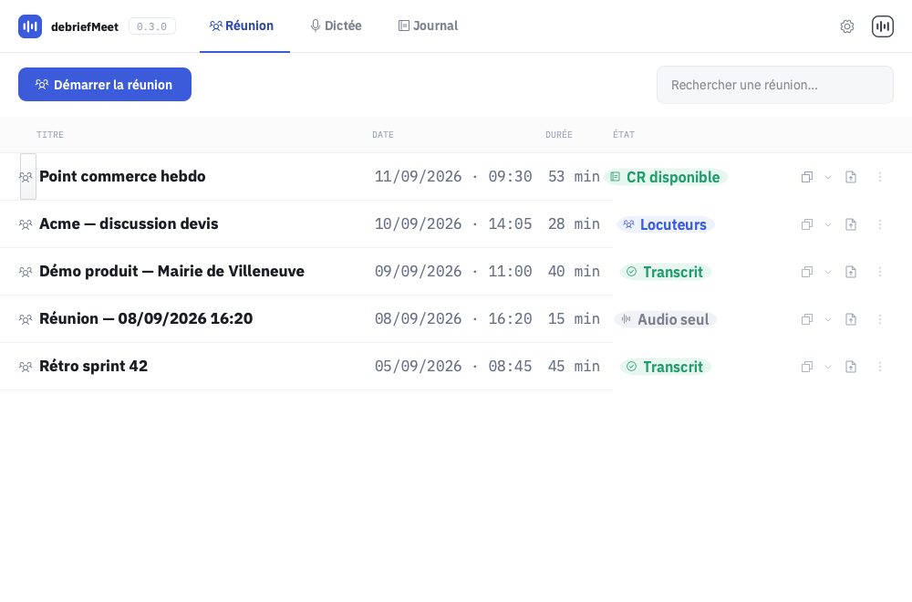
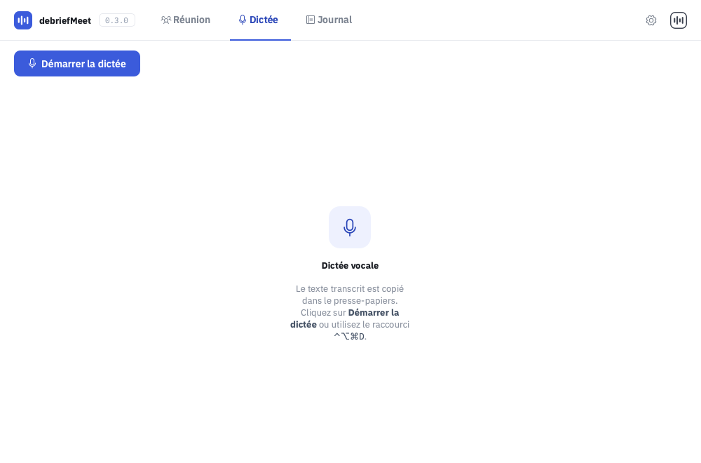
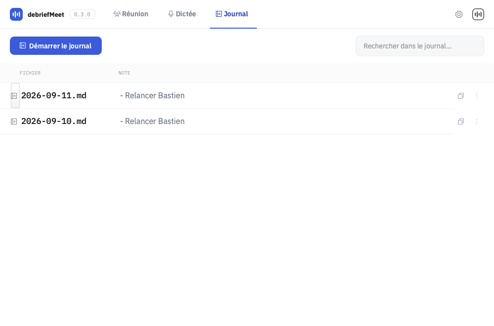
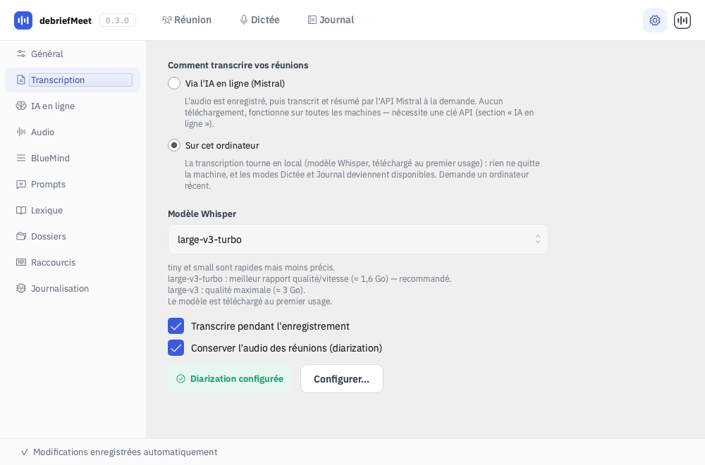
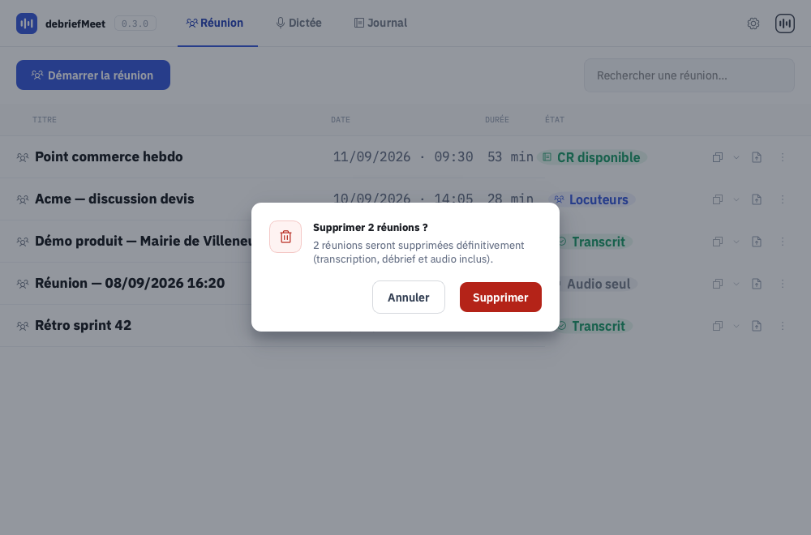
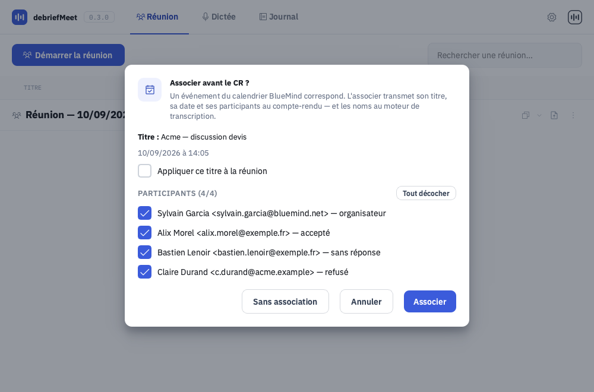
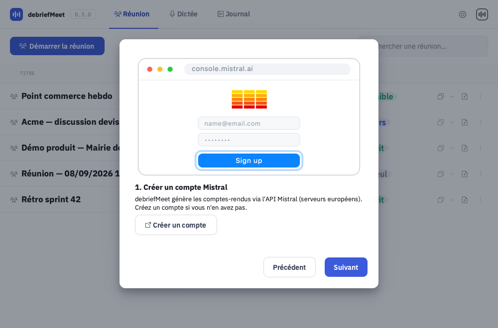
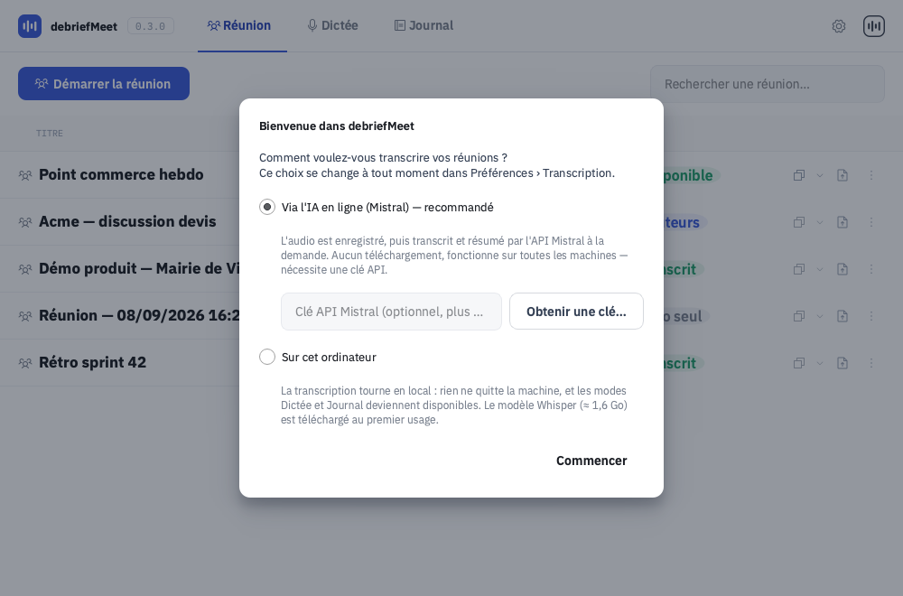
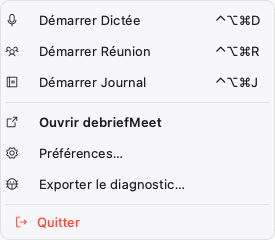

# debriefMeet — état actuel de l'interface (handoff v3, 2026-09-15)

> **À lire en premier.** Ce paquet n'est pas un handoff « designer → développeur » mais
> l'inverse : il décrit **l'interface telle qu'elle existe aujourd'hui dans le code**, après
> quatorze mois d'évolutions et une longue série de correctifs graphiques, pour qu'une
> refonte visuelle puisse repartir du réel et non de la maquette de 2026-07.
>
> Le paquet précédent (`../design_handoff_debriefmeet/`) reste la source des **tokens**
> (couleurs, typo, rayons) : ils n'ont pas bougé. Mais sa description des **écrans** est
> périmée sur presque tous les points (voir §2). En cas de contradiction, **c'est le présent
> document qui fait foi** — il est écrit depuis le code, et les captures de `captures/` sont
> des rendus réels de l'application, pas des maquettes.

| | |
|---|---|
| Produit | debriefMeet — transcription et compte-rendu de réunions, en local ou via API |
| Version décrite | `0.3.0`, branche `main` au 2026-09-15 |
| Techno | Python 3.13/3.14 + **PySide6 (Qt 6) — Qt Widgets**, pas QML |
| OS cibles | **macOS** (Apple Silicon), **Windows 10/11** (x64), **Ubuntu 26.04** (GNOME/Wayland) |
| Fenêtre | une seule, `QMainWindow`, 1000 × 660 au démarrage, redimensionnable |
| Thème | **clair uniquement** (aucun mode sombre aujourd'hui) |
| Langue | interface 100 % française |

---

## Sommaire du paquet

| Fichier | Contenu |
|---|---|
| `README.md` *(ce fichier)* | Le produit, l'inventaire des écrans, les tokens et métriques réels, ce qu'on attend de la refonte |
| `CONTRAINTES-PLATEFORMES.md` | Ce que Qt/QSS sait et ne sait pas faire, puis **les divergences macOS / Windows / Linux**, écran par écran |
| `NE-PAS-REGRESSER.md` | Le journal daté des bugs graphiques corrigés (avec leur cause) + les défauts encore ouverts + ce qui est verrouillé par des tests |
| `captures/*.png` | 24 rendus réels de l'application (offscreen, macOS, données de démonstration) |
| `rendre_captures*.py` | Les scripts qui ont produit ces captures — rejouables pour en obtenir d'autres |

Pour regénérer les captures depuis la racine du dépôt :

```bash
PYTHONPATH=src QT_QPA_PLATFORM=offscreen .venv/bin/python design_handoff_v3/rendre_captures.py design_handoff_v3/captures
```

> Les données visibles dans les captures sont **fictives** (réunions, participants, adresses
> inventées). La capture du Lexique montre le tableau tel qu'il est livré : **vide** — le
> vocabulaire d'une organisation ne vit jamais dans le code (docs/46 §7).

> ⚠️ Les captures sont rendues en **offscreen** (style Qt « Fusion », comme sous Linux).
> Sur macOS, le style natif arrondit un peu les boutons système et supprime certains
> rectangles de focus visibles ici. Les valeurs de géométrie, elles, sont exactes : toute la
> mise en page est calculée en Python.

---

## 1. Le produit en deux minutes

debriefMeet vit **dans la barre d'état système** et s'ouvre en **une seule fenêtre**.
Il enregistre deux pistes audio (le micro de l'utilisateur + le son système de la visio), en
produit une transcription, puis un **compte-rendu** rédigé par une IA.

Trois types de capture, chacun avec sa page :

| Type | Ce que ça fait | Historique ? |
|---|---|---|
| **Réunion** | Enregistre micro + son système, produit `transcription.md`, puis locuteurs et CR à la demande | oui, tableau complet |
| **Dictée** | Enregistre le micro, met le texte dans le presse-papiers à l'arrêt | non |
| **Journal** | Ajoute des notes datées dans un fichier par jour | oui, liste de fichiers |

Deux intercos optionnelles, invisibles tant qu'elles ne sont pas configurées :

- **BlueMind** (calendrier d'entreprise) : associe une réunion enregistrée à un événement du
  calendrier → titre, date et participants enrichissent le CR. Se manifeste par une colonne
  d'icône dans le tableau et un dialogue d'association.
- **Mistral** (API IA, serveurs UE) : transcription (Voxtral) et rédaction du CR.

### Le point le plus structurant pour une refonte : **le mode de transcription**

Une clé de configuration, figée au démarrage, change ce que l'utilisateur voit :

| Mode | Défaut | Onglets visibles dans la barre | Pour qui |
|---|---|---|---|
| **distant** (Mistral) | ✅ **oui, pour tout le monde** | **Réunion** seul + engrenage | tous les postes, y compris anciens |
| **local** (Whisper embarqué) | non | Réunion · Dictée · Journal + engrenage | machines récentes, données qui ne sortent pas |

**Conséquence visuelle à ne pas manquer : dans la configuration par défaut, la barre de
navigation ne contient qu'**un seul onglet**.** Les captures de ce paquet sont prises en mode
*local* (3 onglets) parce qu'elles montrent plus de choses — mais l'écran que voit un nouvel
utilisateur est celui à un onglet. Une barre d'onglets à un seul onglet est un des points
que la refonte doit trancher.

Le mode se choisit à l'**écran de bienvenue** au premier lancement (`captures/14-premier-lancement.png`)
et se change dans Préférences › Transcription (redémarrage proposé).

---

## 2. Ce qui a changé depuis le handoff de 2026-07

La maquette d'origine (direction « C ») a été implémentée, puis l'app a beaucoup bougé.
Tableau de correspondance, pour éviter de repartir d'une description périmée :

| Handoff 2026-07 | Aujourd'hui |
|---|---|
| Onglets **Historique / Préférences** | **Réunion · Dictée · Journal** + bouton engrenage (déjà acté par le CHANGELOG v2) |
| Groupe de démarrage segmenté dans la barre d'outils | **Un bouton Démarrer/Arrêter par page**, dans une barre d'action de section |
| Écran d'enregistrement plein écran (chrono 42 px, waveform animée) | **Supprimé.** L'enregistrement se signale par : icône d'état, bouton Arrêter + point pulsant + chrono, et une ligne « Réunion en cours » en tête du tableau |
| Tableau réunion à 6 colonnes, 210 px d'actions | **7 colonnes** (une colonne « lien calendrier » dédiée) et **178 px** d'actions |
| Actions de ligne = 6 icônes révélées au survol | **3 boutons dédiés toujours visibles** (dont 2 *split buttons* à flèche) + un menu **⋯ exhaustif** ; les boutons inactifs sont peints grisés, jamais masqués |
| Préférences à 7 sections | **10 sections** (ajout de Transcription, IA en ligne, BlueMind, Lexique ; « Modèle » fondue dans Transcription) |
| `QMessageBox` pour les confirmations | **Gabarit de dialogue maison** (overlay + carte), utilisé partout, y compris les assistants |
| Titlebar maison de 40 px | **Titlebar native de l'OS** (la constante `TITLEBAR_H = 40` est un reliquat mort) |
| Pas de notion de job de fond | **Icône d'état orange** pendant les traitements a posteriori + icône de l'opération sur la ligne concernée |
| Une seule chaîne de traitement (Whisper local) | **Deux modes** (distant par défaut), deux intercos, des jobs de plusieurs minutes |

---

## 3. Inventaire des écrans

### 3.1 Coquille : fenêtre + barre d'outils



- `QMainWindow` natif — **décoration de fenêtre système** (feux macOS à gauche, boutons
  Windows/GNOME à droite). L'app ne dessine pas de titlebar.
- `setQuitOnLastWindowClosed(False)` : fermer la fenêtre ne quitte pas l'app, elle reste au
  tray. **La seule sortie est l'item « Quitter » du menu du tray.**
- Barre d'outils : `QWidget#toolbar`, **hauteur fixe 58 px**, fond blanc, filet bas `#E7E9EE`,
  marges horizontales 20 px, espacement 10 px.
  1. **WaveMark** 26 px indigo rempli (logo dessiné par code, pas un asset)
  2. wordmark « debriefMeet » — IBM Plex Sans **15 px / Bold**
  3. badge version — IBM Plex Mono **10.5 px**, `#98A2B3`, bordure `#E7E9EE`, radius 5, padding 1/5
  4. *(espace 16 px)* onglets de type : icône 16 px + label 14 px/600 ; repos `#7A828F`,
     actif `#2A46B8` + soulignement 2 px `#3B5BDB` (hauteur d'onglet = hauteur de barre)
  5. *(spacer)*
  6. engrenage Préférences : 34 × 34, icône 18 px, actif = fond `#EEF1FE`
  7. icône d'état WaveMark 24 px (voir §4)

### 3.2 Page Réunion

**Barre d'action de section** (marges 20/14, filet bas `#EFF1F4`) :
bouton bascule · point pulsant + chrono · *(barre d'actions en masse)* · *(spacer)* · recherche 260 px.

Le bouton bascule a trois états — repos (`#3B5BDB`), enregistrement (`#FF3B30` + « Arrêter »),
et **désactivé** quand un autre type enregistre (fond `#F1F2F5`, texte `#98A2B3`, mention
« Un enregistrement est déjà en cours. »). Il affiche aussi un état transitoire
« Démarrage… / Arrêt… » : l'ouverture du micro est synchrone et peut prendre plusieurs
secondes à froid sous Windows.

**Le tableau** — `QTableView` + modèle maison, tout est peint par des délégués :

| # | Colonne | Largeur | Contenu |
|---|---|---|---|
| 0 | type / job | 40 | icône 16 px, **inset 20 px** à gauche ; barre d'accent 3 px si la ligne est sélectionnée |
| 1 | TITRE | *extensible* | IBM Plex Sans **13.5 / Bold** `#1A1D23`, élidé, **éditable au double-clic** (renomme le dossier sur disque) |
| 2 | DATE | 190 | IBM Plex Mono 12 `#667085` — `JJ/MM/AAAA · HH:MM` |
| 3 | DURÉE | 74 | IBM Plex Mono 12 `#667085` |
| 4 | ÉTAT | 116 | badge pilule (voir §4) |
| 5 | *(lien calendrier)* | 34 | icône 28 × 28 alignée à droite, en-tête vide |
| 6 | *(actions)* | **178** | boutons dédiés + ⋯, alignés à droite |

Hauteur de ligne **52 px**, pas de grille, pas de tri, pas d'alternance de couleur.
Survol = `#FAFAFB` **sur la ligne entière** (chaque délégué peint ce fond lui-même) ;
sélection = `#EEF1FE` + barre d'accent.

**Colonne actions**, de gauche à droite :
`[Générer le CR ▾] [Copier le CR ▾] [Copier le fichier] [⋯]`
— boutons 30 × 30 radius 7, icône 16 px, flèche de *split button* 16 px de large (caret 10 px),
espacement 2 px, marge droite 20 px. Teintes : `#98A2B3` au repos, `#2A46B8` + fond blanc au
survol, `#E9EBEF` au pressé, `#B0B7C0` si inactif. **Un bouton inactif reste peint** (grisé,
infobulle explicative) : la colonne garde la même géométrie d'une ligne à l'autre.

> ⚠️ La largeur 178 est **dérivée** de `NB_BOUTONS_REUNION = 3` et `NB_FLECHES_REUNION = 2`.
> Ajouter un bouton sans toucher ces constantes fait déborder la colonne **par la gauche**,
> par-dessus l'icône calendrier — c'est arrivé le 2026-08-24 (voir `NE-PAS-REGRESSER.md`).

**Menu ⋯** (`captures/07-menu-actions-ligne.png`) : popover maison, **exhaustif** — il contient
toutes les actions de la ligne, y compris celles des boutons dédiés. Items = icône 16 px +
libellé 13 px/500 ; survol `#EEF1FE` + texte/icône `#2A46B8` ; item destructif rouge permanent ;
item indisponible grisé (jamais masqué : l'infobulle dit pourquoi). Largeur = max(238 px, plus
long libellé).

**Ligne « Réunion en cours »** (`captures/02-reunion-enregistrement-en-cours.png`) : insérée en
tête pendant l'enregistrement, badge *En cours* rouge, durée = chronomètre live, icône micro,
**ni sélectionnable ni actionnable**. La vraie réunion est exclue du listing tant qu'elle
enregistre (sinon elle apparaît deux fois).

**Sélection multiple** (`captures/03-reunion-selection-multiple.png`) : dès 2 lignes, une barre
d'actions en masse apparaît dans la barre d'action (filet vertical, compteur « **n** sélectionnés »,
« Ignorer l'audio », « Supprimer », croix de désélection).

### 3.3 Page Dictée



Barre d'action sans recherche + un état vide centré : tuile 60 × 60 `#EEF1FE`, titre
« Dictée vocale » 16/Bold, et une phrase qui rappelle le raccourci en glyphes natifs.

### 3.4 Page Journal



Même ossature, 4 colonnes : icône 40 · **nom de fichier mono** 200 · note (extensible) · actions 82.
Un seul bouton dédié (« Copier ») + ⋯. Pas de ligne « en cours ».

### 3.5 Préférences

10 sections, **toujours les 10** quel que soit le mode (c'est le *contenu* de « Transcription »
qui varie) :

| # | Section | Icône | Contenu |
|---|---|---|---|
| 0 | Général | `sliders-horizontal` | langue, démarrage auto, notifications |
| 1 | Transcription | `file-text` | **choix du mode** (2 radios + notes) puis, en local : modèle Whisper, transcription live, rétention audio, badge diarization |
| 2 | IA en ligne | `brain` | clé API Mistral, modèles, durée max, test de connexion |
| 3 | Audio | `waveform` | micro, intervalle, annulation d'écho |
| 4 | BlueMind | `list` | URL, email, clé, TLS, test, notifications de début de réunion, reset de sync |
| 5 | Prompts | `chat-text` | liste + éditeur (titre / contenu mono) + prompt actif |
| 6 | Lexique | `book-open` | tableau « Entendu → À écrire » |
| 7 | Dossiers | `folders` | 2 chemins mono + « Choisir… » |
| 8 | Raccourcis | `keyboard` | 1 à 3 `QKeySequenceEdit` + réinitialisation |
| 9 | Journalisation | `bug` | 2 cases, emplacement, ouvrir / exporter (.zip) / vider |



- Sous-nav 208 px (`#FBFBFC`, filet droit), items 13.5/600, sélection `#EEF1FE` / `#2A46B8`.
- Panneau défilant, contenu **ancré en haut à gauche**, padding 30/26, largeur max par section
  (440 à 620 px selon le contenu).
- **Auto-save** : aucun bouton OK/Annuler, chaque champ persiste immédiatement (champs texte
  débouncés à 400 ms). Barre de pied « Modifications enregistrées automatiquement ».
- Les sections Prompts et Lexique portent des listes/tableaux avec deux **mini-boutons carrés
  32 × 28** `+` / `−`.

Toutes les sections sont capturées : `captures/06-preferences-0-*.png` → `06-preferences-9-*.png`.

### 3.6 Dialogues




Un **gabarit unique** remplace toutes les `QMessageBox` :

- Voile `rgba(16,24,40,.45)` + carte blanche radius 12, ombre portée (blur 44, offset 0/10).
- La carte est un **widget enfant de la fenêtre** : elle suit les déplacements et
  redimensionnements. Conséquence assumée : la modalité est *fenêtre*, pas *application*.
- **En-tête** (tuile 40 × 40 + titre 15/Bold + description 13 `#667085`) et **pied** fixes ;
  seul le **corps défile**. C'est ce qui garantit que les boutons restent atteignables — un
  événement à 34 invités poussait autrefois le pied hors de l'écran.
- Deux intentions : `ACCENT` (bouton indigo) et `DESTRUCTIF` (bouton rouge `#B42318`).
  Jamais de « OK / Yes » générique : le bouton porte le verbe (« Supprimer », « Envoyer »,
  « Remplacer », « Associer »).
- Un troisième bouton secondaire peut s'insérer avant « Annuler » (« Sans association »).
- Largeurs de carte en usage : 380 (confirmations) · 440 (détail) · 460 (locuteurs) ·
  470 (bienvenue) · 520 (assistants) · 580 (association).

### 3.7 Assistants guidés



Deux assistants pas-à-pas (obtenir une clé Mistral ; activer la diarization) : maquette SVG de
l'écran tiers visé, titre, paragraphe, bouton « ouvrir le navigateur », navigation
Précédent/Suivant, dernière étape = travail en tâche de fond avec barre indéterminée.
Les 9 maquettes SVG (`diar_etape_1..5`, `mistral_etape_1..4`) sont **volontairement
schématiques** : elles portent les libellés exacts à chercher sur le site tiers, pas un rendu
fidèle qui deviendrait faux au premier redesign de ce site.

### 3.8 Écran de bienvenue



Carte 470 px jouée une seule fois : choix du mode + champ de clé API optionnel.
Fermer sans choisir = mode distant.

### 3.9 Barre d'état système (tray)



- **Icône** = WaveMark, dont **seule la couleur encode l'activité** (voir §4).
- **Menu** : c'est le seul endroit où l'app **abandonne sa typo maison** pour la police système,
  et imite le rendu d'un menu contextuel natif (fond translucide, item par défaut en gras,
  raccourcis à droite, « Quitter » en rouge). C'est aussi l'écran **le plus divergent entre
  les trois OS** — voir `CONTRAINTES-PLATEFORMES.md` §3.
- **Notifications système** (8 au total) : micro perdu / rétabli, aucun son capté, rien
  entendu, locuteurs générés, diarization échouée, réunion qui commence. Un clic dessus ouvre
  la fenêtre sur la bonne réunion.

---

## 4. Le système d'états

### 4.1 Icône d'état (tray + barre d'outils, même source)

| État | Couleur | Traitement |
|---|---|---|
| Repos | `#3D4351` (macOS/Windows) · `#FFFFFF` (Linux) | **contour** monochrome |
| Enregistrement | `#FF3B30` | rempli |
| Traitement (transcription, locuteurs, CR) | `#FF9500` | rempli |
| Terminé | `#34C759` | rempli, flash 3 s |
| Erreur | `#8E8E93` | rempli, flash 3 s |

Un arbitre central fusionne deux sources : l'enregistrement **gagne toujours** sur un job de
fond ; sinon flash de fin de job ; sinon job en cours (orange) ; sinon repos.

> ⚠️ Le WaveMark **rempli** peint ses barres en blanc sur le carré coloré : demander un
> « blanc plein » produit un carré blanc uni, sans la marque. Une icône monochrome claire
> s'obtient **en contour**.

### 4.2 Badges d'état de ligne (pilule, radius 20)

| Badge | Texte/icône | Fond | Icône |
|---|---|---|---|
| En cours | `#FF3B30` | `#FFECEA` | `record-fill` |
| Transcrit | `#1F9D6B` | `#E7F6EF` | `check-circle` |
| Audio seul | `#7A828F` | `#F1F2F5` | `waveform` |
| Locuteurs | `#3B5BDB` | `#EEF1FE` | `users-three` |
| CR disponible | `#1F9D6B` | `#E7F6EF` | `notebook` |

### 4.3 Icône de job sur la ligne concernée

Pendant un traitement a posteriori, la colonne 0 de **la** réunion traitée remplace son icône
par celle de l'opération, teintée `#FF9500` : `file-text` (transcription), `users` (locuteurs),
`notebook` (CR), `arrows-clockwise` (type inconnu) — avec infobulle. Le tray dit *qu'un* job
tourne, la ligne dit *lequel* et *sur quoi*.

---

## 5. Tokens et métriques réels

Tout vit dans `src/debrief_meet/ui/theme.py` (classes `C` et `M`) + `assets/theme.qss`.
**Aucune valeur en dur ailleurs** — c'est une règle du projet, à conserver.

### Couleurs

```
Accent        ACCENT #3B5BDB · ACCENT_INK #2A46B8 · ACCENT_SOFT #EEF1FE
Texte         INK900 #1A1D23 · INK700 #344054 · INK600 #475467 · INK500 #667085
              INK400 #7A828F · INK350 #8A919E · INK300 #98A2B3 · INK200 #B0B7C0
Surfaces      SURFACE #FFFFFF · SUNKEN #F6F7F9 · HEADER #FBFBFC · HOVER #FAFAFB
Bordures      BORDER #E7E9EE · BORDER_SOFT #EFF1F4 · DIVIDER #F1F2F5
              CONTOUR_FENETRE #B0B7C0  (liseré Wayland, cf. plateformes)
États         REC #FF3B30 / #FFECEA · SUCCESS #1F9D6B / #E7F6EF
              NEUTRAL #7A828F / #F1F2F5 · INFO #3B5BDB / #EEF1FE
              DANGER #B42318 / #FEF3F2 (bordure #F4C9C7) · JOB #FF9500
Tray          IDLE #3D4351 · IDLE_BARRE_SOMBRE #FFFFFF · RECORDING #FF3B30
              TRANSCRIBE #FF9500 · DONE #34C759 · ERROR #8E8E93
```

Règle en vigueur : `#FF3B30` = **activité d'enregistrement**, `#B42318` = **action destructive**.
Deux rouges distincts, jamais interchangés.

### Métriques

```
TOOLBAR_H 58 · ROW_H 52 · PREF_NAV_W 208 · PAD_CONTENT 20 · PAD_FORM 30
Rayons : fenêtre 12 · carte 9–12 · bouton 9 · tuile 7 · pilule 20 · case à cocher 5
Espacement : multiples de 4 (4 6 8 10 12 14 16 20 24 28 30)
TITLEBAR_H 40 — constante morte, plus aucune titlebar maison
```

### Typographie

**IBM Plex Sans** (400/500/600/700) pour l'interface, **IBM Plex Mono** (400/500) pour toute
donnée technique : dates, heures, durées, chronomètre, chemins, noms de fichiers, raccourcis,
numéro de version, noms de modèles, contenu des prompts. Les deux sont **embarquées** dans le
bundle — jamais de dépendance à une police système, **sauf** le menu du tray (§3.9).

### Iconographie

**40 SVG Phosphor Regular** embarqués, teintés à la volée. La liste exacte :

`arrow-square-out · arrows-clockwise · book-open · brain · bug · calendar-check · calendar-plus ·
caret-down · caret-up · caret-up-down · chat-text · check · check-circle · clock-counter-clockwise ·
copy · cursor-click · dots-three-vertical · file-arrow-up · file-text · folder · folders · gear ·
keyboard · list · magnifying-glass · microphone · microphone-slash · minus · notebook · plus ·
record-fill · sign-out · sliders-horizontal · stop · trash · users · users-three · warning-circle ·
waveform · x`

> ⚠️ **Toute icône proposée par la refonte doit exister dans cette liste, ou être livrée en
> SVG.** Un nom d'icône inventé a fait planter l'application chez une utilisatrice en 2026-08 ;
> un test statique refuse désormais toute référence à un fichier absent.

Le logo (« WaveMark ») est **dessiné par code**, pas chargé : carré arrondi (rayon 0,27 × taille)
+ 4 barres de hauteurs 29 % · 50 % · 23,5 % · 41 %, largeur 0,088, gap 0,072, contour 0,06.

> ⚠️ L'icône d'**application** (Dock / barre des tâches / .deb) est **différente** : carré bleu
> `#5AB0FF → #0A74E6` avec 5 barres blanches, marge de 80 % conforme au Dock macOS. Deux
> identités graphiques cohabitent donc aujourd'hui (bleu système vs indigo de marque). C'est un
> arbitrage à reprendre.

---

## 6. Ce qu'on attend de la refonte

### Périmètre

1. **Trancher les points ouverts** listés dans `NE-PAS-REGRESSER.md` §2 — en particulier :
   la barre à un seul onglet en mode distant, l'absence d'états vides, la lisibilité de la
   colonne d'actions (4 icônes muettes par ligne), le mode sombre, la double identité d'icône.
2. **Reprendre les écrans** de §3 avec leurs états réels : repos / survol / pressé / désactivé /
   sélectionné / focus clavier, et les états de données (vide, 1 ligne, 200 lignes, titre très
   long, job en cours, enregistrement en cours).
3. **Traiter explicitement les trois OS** : voir `CONTRAINTES-PLATEFORMES.md`. Une proposition
   qui ne dit rien de GNOME/Wayland sera intenable à implémenter.

### Format de livraison utile

- Maquettes à **1000 × 660** (taille de démarrage) **et** à ~1440 × 900, plus un cas étroit
  (~820 px) : la fenêtre est librement redimensionnable et les tableaux s'étirent.
- **Valeurs exactes** (hex, px, poids) plutôt que des intentions : tout est réimplémenté à la
  main en QSS/Python, il n'y a pas d'export de style.
- Pour chaque composant nouveau, dire **comment il se peint** : widget stylé en QSS, ou dessin
  dans un délégué. Les cellules de tableau et les items de menu maison sont **peints à la
  main** — un effet qui suppose du CSS moderne ne sera pas implémentable tel quel (§1 de
  `CONTRAINTES-PLATEFORMES.md`).

### Ce qu'il vaut mieux ne pas proposer

- Du flou d'arrière-plan (`backdrop-filter`), des transitions CSS, des ombres portées sur des
  éléments plats, des bordures fractionnaires (0,5 px), des dégradés complexes : Qt n'a rien
  d'équivalent en feuille de style — chacun coûte un widget peint à la main ou un effet Qt.
- Un style d'item de menu piloté par sélecteur : impossible de cibler *un* item en QSS. Tous
  nos menus « riches » sont déjà des widgets custom, avec le coût que ça implique.
- Une dépendance à une police ou une icône système.
- Une identité qui repose sur le mode sombre : il n'existe pas aujourd'hui, l'ajouter est un
  chantier à part entière (tout le QSS et ~70 `setStyleSheet` locaux sont écrits en couleurs claires
  en dur).
