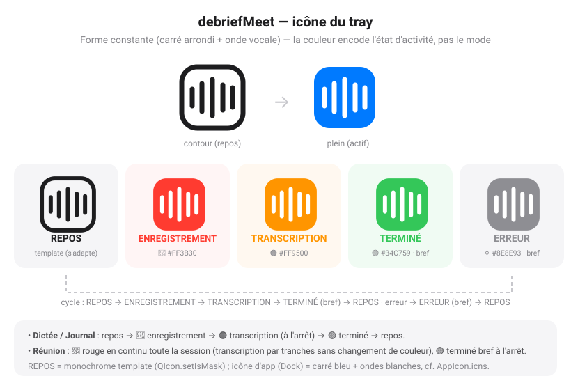

# Spécifications fonctionnelles — debriefMeet

> **Statut :** v1 — spécifications **fonctionnelles** validées.
> Les spécifications **techniques** (stack, architecture détaillée, choix d'implémentation par OS) feront l'objet d'un second document, une fois la stack tranchée.
>
> Ce document est conçu pour être donné tel quel à une IA comme **contexte de référence**. Il décrit *quoi* construire et *comment ça doit se comporter*, pas *avec quelle technologie*.

---

## 1. Contexte et objectif

`debriefMeet` est une **réécriture from scratch** d'un logiciel existant de reconnaissance vocale locale.

L'existant (dossier de référence `manu-whisper/whiper-master/`) est une application Python + PyQt6 qui fonctionne, mais qui n'est **pas satisfaisante** sur deux plans :

1. **Maintenabilité** : le code diverge par OS — deux scripts séparés (`whisper.py` pour Linux, `whisper_mac.py` pour macOS), ~900 lignes chacun à maintenir en parallèle, plomberie système éclatée (presse-papiers, audio système, autostart, raccourcis tous différents et dupliqués).
2. **Couverture OS** : pas de support Windows ; distribution douloureuse (venv Python + CUDA + compilation Swift + permissions à la main).

**Objectif de la réécriture :**

- Reproduire **les mêmes fonctionnalités** que l'existant (parité v1), avec une base de code **maintenable**.
- Fonctionner **aussi bien sur macOS, Windows et Linux** — les **trois OS sont des cibles de premier rang, à parité**.
- Rester une **application lourde native** (pas une web app), pilotée principalement depuis l'**icône de la zone de notification (tray)**.
- Rester **100 % locale par défaut** : aucune donnée audio ou texte n'est envoyée vers un service cloud, tout le traitement se fait sur la machine — **sauf activation explicite** par l'utilisateur d'une interco cloud optionnelle (ex. génération de CR via Mistral, docs/42), strictement opt-in, invisible tant que non configurée, avec confirmation avant le premier envoi.

### Le parti pris technique majeur (déjà acté)

Le **moteur de transcription est volontairement différent et optimisé par OS** — on ne cherche pas un moteur unique « du plus petit dénominateur commun », on veut **la meilleure performance native sur chaque plateforme** :

- **macOS (Apple Silicon)** : moteur optimisé Metal/Neural Engine (ex. `mlx-whisper`).
- **Windows / Linux avec GPU NVIDIA** : moteur optimisé CUDA (ex. `faster-whisper`/CTranslate2).
- **GPU non-NVIDIA (AMD, Intel…)** : l'accélération **ne doit pas être réservée à NVIDIA** à terme. **En v1**, ces machines fonctionnent en **CPU** (donc opérationnelles, mais plus lentes) ; l'accélération via un backend adapté (Vulkan, etc.) est **prévue en v2** et l'architecture est conçue pour l'accueillir sans refonte.
- **Repli CPU** quand aucun GPU exploité n'est disponible (et seul mode pour AMD/Intel en v1).

Conséquence d'architecture (à détailler dans le doc technique) : on définit **une interface commune `MoteurTranscription`** et on branche derrière **la meilleure implémentation native par plateforme**. Tout le reste de l'application (UI, modes, fichiers, raccourcis) doit être **indépendant du moteur** et partagé entre OS.

---

## 2. Principes directeurs

| Principe | Implication |
|---|---|
| **100 % local par défaut, zéro cloud** | Aucune transcription, audio ou note ne quitte la machine. Pas de télémétrie. Exception strictement opt-in : interco Mistral optionnelle pour générer un CR (docs/42), invisible tant que non activée. |
| **App lourde native** | Application de bureau installée, pas un site/PWA. Intégration système réelle (tray, raccourcis, autostart). |
| **Tray-first** | Le point d'entrée principal est l'icône du tray. L'app vit en arrière-plan, discrète. |
| **Moteur optimisé par OS** | Performance native maximale ; le moteur est isolé derrière une interface commune. |
| **Cœur partagé, plomberie isolée** | La logique métier (modes, formats de fichiers, états) est commune à tous les OS. Seules les briques système (audio, presse-papiers, raccourcis, autostart, moteur) sont spécialisées par OS, derrière des interfaces. |
| **Maintenabilité** | Un seul code applicatif. Les différences OS sont localisées, nommées et minimales. |
| **Réactivité perçue** | Le lancement d'une action depuis le tray ou un raccourci doit être quasi instantané. Le modèle reste chargé en mémoire entre deux usages. |

---

## 3. Périmètre

### Dans la v1

- Les **3 modes** : Dictée, Réunion, Journal (parité avec l'existant).
- **Pilotage par le tray** (menu clic droit) + **raccourcis globaux**.
- **Fenêtre de préférences** graphique (remplace les arguments CLI de l'existant).
- **Auto-détection de la langue** (avec repli sur langue forcée).
- **Gestion des modèles** Whisper (choix, téléchargement, cache) depuis l'UI.
- **Démarrage automatique au login** en opt-in.
- **Notifications système** et **état porté par l'icône du tray**.
- **Annulation d'écho** sans casque, **rétention audio** + **transcription différée**, et **diarisation « qui a parlé »** (passe finale post-réunion) — ajoutés au-delà du périmètre initial (cf. docs 06/07/10/13).
- Cibles : **macOS, Windows et Linux** — les trois à **parité** (premier rang, même niveau d'exigence).

### Repoussé à plus tard (hors v1, mais l'archi doit les anticiper)

- **Génération de compte-rendu intégrée** (appel LLM API ou local). → Le format `.md` produit doit rester propre et directement exploitable par un LLM.
- **Transcription en streaming live** (affichage au fil de la parole).
- **Auto-collage** du texte dicté (insertion directe au curseur).
- **Gestion intégrée des raccourcis globaux** (capture clavier native dans l'app + redéfinition dans les préférences). → En v1, on passe par les outils natifs de l'OS (cf. §11). L'interface `RaccourcisGlobaux` est prévue dans l'archi.
- **Accélération GPU AMD / Intel** (via Vulkan, etc.). → En v1, ces machines tournent en CPU ; l'archi prévoit le branchement d'un moteur Vulkan en v2 (POC requis).

Ces éléments sont documentés ici comme **non-objectifs v1** afin que l'IA ne les implémente pas, tout en gardant les points d'extension ouverts.

---

## 4. Profil d'usage

- Utilisateur unique sur sa machine (poste de travail).
- Usages typiques :
  - **Dictée** : rédiger un message/mail/ticket à la voix, coller le résultat dans n'importe quelle app.
  - **Réunion** : capturer une visio (Teams, Jitsi, LiveKit…) pour en tirer un compte-rendu ensuite (collé manuellement dans un LLM en v1).
  - **Journal** : consigner au fil de la journée des notes d'activité horodatées, pour un bilan hebdo/mensuel.
- L'utilisateur veut **déclencher vite** une action (raccourci clavier ou clic droit sur le tray) sans casser son flux de travail.

---

## 5. Vue d'ensemble de l'interface

### 5.1 Icône du tray (point d'entrée principal)

L'app réside dans la zone de notification. Comme l'interface est **tray-only**, c'est l'icône (et les notifications) qui portent le retour visuel que la fenêtre flottante assurait dans l'existant.



#### 5.1.1 Forme de l'icône

Un **carré arrondi** (bulle/messagerie, rappel de l'identité BlueMind) contenant une **forme d'onde vocale** (5 barres verticales de hauteurs variables). Style **« à la Apple »** : silhouette épurée, coins arrondis, logique **contour (repos) → plein (actif)**. *(La queue de bulle a été retirée pour la lisibilité, notamment en contour à petite taille.)*

- **Forme constante** quel que soit l'état ; c'est la **couleur** (et contour/plein) qui change.
- Dessinée **programmatiquement** (aucun asset image requis) dans un repère logique 100×100, donc nette à toute taille (barre de menu ≈ 22 px, Retina, etc.).
- Implémentation de référence : `src/debrief_meet/ui/icones.py`, fonction `icone_pour_etat(etat, taille)`.
- **Icône d'application** (Dock/Finder) : même motif, en version **colorée** — carré arrondi **bleu** système (dégradé) avec les **ondes blanches** directement dessus. Suit les guidelines macOS (carré, marges ~80 %, pas d'ombre intégrée). Fichier `.icns` généré par `scripts/generer_icone.py` (cf. `dessiner_icone_app`).

#### 5.1.2 La couleur encode l'état d'activité (et non le mode)

Point de conception **important** : la couleur ne dépend **pas** du mode (Dictée/Réunion/Journal) mais de **ce que l'app est en train de faire**. Énumération `EtatVisuel` (`src/debrief_meet/core/modes.py`) :

| État | Rendu de l'icône | Couleur | Signification |
|---|---|---|---|
| **REPOS** | Carré arrondi en **contour**, **monochrome template** (s'adapte clair/sombre de la barre) | — (encre système) | App lancée, en attente |
| **ENREGISTREMENT** | Carré **plein**, ondes en réserve | 🔴 `#FF3B30` | Capture audio en cours |
| **TRANSCRIPTION** | Carré **plein** | 🟠 `#FF9500` | Transcription en cours (Dictée / Journal, à l'arrêt) |
| **TERMINE** | Carré **plein**, **bref** (~1,5 s) puis retour REPOS | 🟢 `#34C759` | Transcription terminée (texte copié / fichier écrit) |
| **ERREUR** | Carré **plein**, **bref** puis retour REPOS | ⚪ `#8E8E93` *(placeholder, ajustable)* | Échec de transcription (détail en notification / log) |

- **REPOS = template** : techniquement `QIcon.setIsMask(True)`, donc macOS la recolore selon le thème de la barre de menu (noire en clair, blanche en sombre). Aucune couleur de marque n'est imposée au repos.
- **États colorés = non-template** : la couleur est conservée telle quelle (carré plein + ondes blanches en réserve).

#### 5.1.3 Cas du mode Réunion

La Réunion **enregistre et transcrit par tranches en continu**. Elle reste **🔴 rouge (ENREGISTREMENT) toute la session** — la transcription incrémentale par tranches **ne fait pas** passer l'icône en orange. À l'arrêt : 🟢 vert bref, puis retour REPOS.

> En Phase 0 (adaptateurs *stubs*, pas de chaîne de transcription réelle), le tray ne bascule qu'entre **REPOS ↔ ENREGISTREMENT**. Les états TRANSCRIPTION / TERMINE / ERREUR sont câblés à partir de la **Phase 1**, quand le pipeline réel existe (point d'entrée déjà prêt : `IconeTray.definir_etat_visuel(etat)`).

### 5.2 Menu clic droit du tray (actions rapides)

Le menu contextuel doit permettre de **déclencher toutes les actions sans la fenêtre** :

- **Démarrer / Arrêter Dictée** (libellé qui bascule selon l'état)
- **Démarrer / Arrêter Réunion**
- **Démarrer / Arrêter Journal**
- — séparateur —
- **Historique des enregistrements…** (ouvre la fenêtre dédiée — cf. §5.5)
- **Ouvrir le dossier des réunions**
- **Ouvrir le dossier du journal**
- — séparateur —
- **Préférences…**
- **À propos**
- **Quitter**

> Un seul mode actif à la fois (voir §6). Le menu reflète l'état : pendant qu'un mode est actif, son entrée affiche « ⏹ Arrêter X » et les **autres modes sont grisés / non cliquables** (l'exclusivité est portée par le grisage, pas par un message d'erreur). Au retour au repos, toutes les entrées redeviennent actives.

### 5.3 Fenêtre de préférences (à la demande)

Fenêtre classique ouverte depuis le menu tray. Contenu détaillé en §10. Elle n'est **pas** affichée au démarrage.

### 5.4 Fenêtre flottante

**Non incluse en v1** (choix : tray-only). À garder comme évolution possible mais sans l'implémenter.

### 5.5 Fenêtre Historique des enregistrements

Fenêtre dédiée ouverte depuis le menu tray (« Historique des enregistrements… »). Elle liste les **enregistrements produits** par l'app et permet d'agir dessus sans ouvrir un explorateur de fichiers. **Portée : réunions ET journal.**

> **Refonte détaillée :** [`docs/09-refonte-historique.md`](09-refonte-historique.md) (colonne d'actions, jobs de fond, sélection multiple). Cette section donne la vue fonctionnelle.

**Contenu :**

- **Deux catégories** : Réunions et Journal (onglets), alimentées en lisant les dossiers de sortie (§10.3).
- Liste triée par **date décroissante** (le plus récent en haut). Chaque réunion affiche un **titre éditable** (double-clic — par défaut la date), la **date · heure** (issues du nom de fichier) et la **durée** ([`docs/14`](14-titre-duree.md)). Indicateurs par ligne : audio retenu présent, à transcrire, locuteurs générés.
- **Rafraîchissement live** : la liste se met à jour si un enregistrement apparaît / un job se termine pendant qu'elle est ouverte, en préservant la sélection.
- **Sélection multiple** (⌘/⇧) pour les suppressions de masse.

**Actions par entrée (v1) :**

| Action | Comportement |
|---|---|
| **Copier la transcription** | Copie le `.md` (ou le débrief `_locuteurs.md` s'il existe) dans le presse-papiers, **préfixé du prompt actif** s'il y en a un (§10.4bis). Action mise en avant. |
| **Transcrire** *(réunion « audio seul »)* | Lance la transcription différée d'une réunion enregistrée sans transcription ([`docs/10`](10-transcription-differee.md)). En tâche de fond. |
| **Générer les locuteurs** *(réunion)* | Lance la diarization « qui a parlé » (passe finale) en tâche de fond. Grisé tant que la diarization n'est pas configurée (§10.2). |
| **Ouvrir le fichier** | Ouvre le `.md` dans l'éditeur par défaut. |
| **Révéler dans le Finder** | Montre le fichier dans le Finder / Explorateur. |
| **Supprimer l'audio** *(réunion)* | Supprime les pistes audio retenues, garde le compte-rendu. |
| **Tout supprimer** | Supprime l'enregistrement (transcription + locuteurs + audio) après confirmation. |

**Actions prévues plus tard (NON v1, à anticiper dans l'UI) :**

- **Générer un résumé / compte-rendu** via un LLM (API externe ou modèle local) — bouton par enregistrement. Aujourd'hui l'utilisateur copie le `.md` (préfixé du prompt) dans un LLM ; demain un bouton ferait l'appel. Voir §3 et §19.

**Règles :**

- Les jobs de fond (transcription différée, diarization) sont portés par un **gestionnaire persistant** : fermer la fenêtre n'interrompt pas un job en cours, qui notifie à la fin.
- L'app **ne réécrit pas le corps** des transcriptions ; elle ne modifie que le **titre** (H1) et la **durée** (métadonnée), et réécrit le `.md` lors d'une transcription différée demandée.
- Le format `.md` (§12) est la **source unique** de ces entrées — aucune base de données séparée requise.

---

## 6. Règle transversale : un seul mode actif

- À tout instant, **au plus un mode** est actif (Dictée, Réunion ou Journal).
- Déclencher un mode alors qu'un autre est actif est **refusé** (notification explicative) — on ne démarre pas deux captures simultanées.
- Chaque mode fonctionne en **bascule (toggle)** : la même action démarre puis arrête.

---

## 7. Mode Dictée 🎤

**But :** dicter du texte et le récupérer dans le presse-papiers pour le coller où on veut.

### Déroulé

1. L'utilisateur déclenche la dictée (menu tray, ou raccourci global, ou re-clic). → icône **ENREGISTREMENT** 🔴 (cf. §5.1.2).
2. Il parle.
3. Il re-déclenche (même action / même raccourci) pour arrêter. → icône **TRANSCRIPTION** 🟠.
4. La transcription se lance (à l'arrêt, **pas** en live).
5. Le texte est **copié dans le presse-papiers**. → icône **TERMINE** 🟢 (bref, puis retour REPOS) + notification « Texte copié ✓ ».
6. L'utilisateur colle avec `Cmd+V` (macOS) / `Ctrl+V` (Windows/Linux) dans l'application de son choix.

### Règles

- La langue est **auto-détectée** (cf. §13).
- Le presse-papiers est le **seul** canal de sortie en v1 (pas d'auto-collage).
- En cas d'audio vide / inintelligible : notification « Rien à transcrire », pas d'écriture du presse-papiers.
- Le texte doit être **nettoyé** des artefacts courants (espaces superflus en début/fin). Pas de post-traitement LLM.

---

## 8. Mode Réunion 📋

**But :** capturer une visio (sa propre voix **+** l'audio système) et produire un compte-rendu brut au format Markdown, enrichi en continu.

### Déroulé

1. L'utilisateur rejoint sa visio puis déclenche le mode Réunion. → Enregistrement de **deux sources simultanées** : le **micro** et l'**audio système (loopback)**.
2. Un fichier `.md` est **créé immédiatement** au démarrage (cf. §12.1).
3. La transcription se fait **par tranches périodiques** (intervalle par défaut : **30 s**, configurable) et chaque tranche est **ajoutée au fichier** au fil de l'eau.
   - Conséquence importante : **si l'app plante, tout ce qui a déjà été transcrit est conservé** sur disque.
4. L'utilisateur arrête le mode en fin de réunion. → **Finalisation** (transcription de la dernière tranche), puis icône **TERMINE** 🟢 (bref) + notification avec le chemin du fichier.
   > Pendant toute la session, l'icône reste **ENREGISTREMENT** 🔴 (la transcription par tranches ne la fait pas passer en orange — cf. §5.1.3).

### Règles

- **Deux sources audio** : micro + audio système. Le fichier distingue, quand c'est possible, **« Moi »** (micro) des **« Participants »** (audio système).
  > La capture de l'audio système est la brique **la plus dépendante de l'OS** : **ScreenCaptureKit** (macOS 13+, **permission Enregistrement de l'écran**), WASAPI loopback (Windows), **moniteur PipeWire (Linux)**. Sous Linux, on cible **PipeWire uniquement** en v1 ; le support PulseAudio est repoussé. Cette brique doit être isolée derrière une interface commune (détaillée dans le doc technique).
- **Annulation d'écho sans casque** (option `aec_actif`) : nettoie le micro de l'écho des haut-parleurs pour que « Moi » ne reprenne pas la voix des participants — cf. [`docs/06`](06-integration-aec.md).
- **Conservation de l'audio** : par défaut l'audio est jeté après transcription (seul le `.md` subsiste). Deux options changent ça :
  - **Rétention audio** (`retention_audio`) : garde les 2 pistes à côté du `.md` pour générer la diarization plus tard.
  - **Mode « enregistrement seul »** (`transcription_live` décoché) : la réunion n'enregistre que l'audio (rétention forcée) ; la transcription est lancée **après**, à la demande, depuis l'Historique — cf. [`docs/10`](10-transcription-differee.md).
- **Diarisation « qui a parlé »** : passe finale post-réunion à la demande (pyannote), produisant `<stem>_locuteurs.md` — cf. [`docs/07`](07-diarization.md). Activation guidée via l'assistant des Préférences (§10.2).
- Intervalle de transcription **configurable** (défaut 30 s) ; un intervalle plus long améliore la qualité de segmentation au prix de la fraîcheur.

---

## 9. Mode Journal ✎

**But :** consigner des notes d'activité horodatées au fil de la journée, dans un fichier Markdown quotidien.

### Déroulé

1. L'utilisateur déclenche le Journal (menu tray ou **raccourci dédié, distinct de la dictée**). → icône **ENREGISTREMENT** 🔴.
2. Il dicte sa note.
3. Il re-déclenche pour arrêter. → icône **TRANSCRIPTION** 🟠 (à l'arrêt).
4. L'entrée transcrite est **horodatée et ajoutée à la suite** du fichier du jour (créé s'il n'existe pas). → icône **TERMINE** 🟢 (bref) + notification.

### Règles

- Le fichier du jour est **append-only** : l'historique de la journée est préservé, chaque entrée horodatée (cf. §12.2).
- Langue auto-détectée.
- Sortie : fichier seulement (pas de presse-papiers), contrairement à la Dictée.

---

## 10. Préférences (fenêtre graphique)

Remplace les arguments CLI de l'existant (`--model`, `--device`, `--output`, etc.). Réglages persistés (cf. §15). Éléments à régler :

### 10.1 Modèle Whisper
- Choix du modèle : `tiny` / `base` / `small` / `medium` / `large-v2` / `large-v3`. **Défaut : `large-v3`**.
- **Téléchargement au premier lancement** : si le modèle configuré n'est pas en cache, une **fenêtre de progression** le télécharge (une seule fois) avant que l'app soit prête — cf. [`docs/15`](15-changement-modele.md).
- **Changement de modèle à chaud** : choisir un autre modèle le **télécharge (si absent) puis l'active sans redémarrer** l'app (barre de progression).
- Affichage de l'espace de cache utilisé ; possibilité de **supprimer un modèle** du cache.
- Indication de l'**accélération active** détectée (Metal / CUDA / CPU).

### 10.2 Audio (onglet)
- Sélection du **micro d'entrée** (liste des périphériques, défaut système identifié), avec **rafraîchissement à chaud** (brancher/débrancher un casque sans relancer l'app).
- **Transcription** : « transcrire pendant l'enregistrement » (défaut) ou décoché → **mode enregistrement seul** (transcription différée, §8).
- **Annulation d'écho** sans casque (`aec_actif`).
- **Rétention audio** des réunions (prérequis de la diarization).
- **Diarization** : libellé d'état (✅ configurée / non configurée) + bouton **« Configurer la diarization… »** ouvrant l'**assistant guidé** (compte Hugging Face → licence → token → téléchargement). Le token est utilisé à la volée puis **jamais enregistré** — cf. [`docs/13`](13-diarization-onboarding.md).
- **Intervalle de transcription** du mode Réunion (défaut 30 s).

### 10.3 Dossiers de sortie
- Dossier des **réunions** (défaut : `~/reunions/`).
- Dossier du **journal** (défaut : `~/activites_quotidiennes/`).
- Modifiables graphiquement (sélecteur de dossier).
- Le dossier choisi est **créé automatiquement s'il n'existe pas** ; si le chemin est invalide ou non inscriptible, l'app le signale et conserve l'ancien.
- Changer un dossier **ne déplace pas** les fichiers déjà produits ; les anciens restent à leur emplacement (l'app n'écrit que les nouveaux enregistrements dans le nouveau dossier).
- La **fenêtre Historique (§5.5)** liste les enregistrements présents dans les dossiers **actuellement configurés**.

### 10.4 Raccourcis globaux
- **macOS** : la redéfinition des raccourcis **dans l'app** (capture clavier native via Carbon, gestion des conflits) est implémentée — cf. §11 et `docs/28`. Onglet **« Raccourcis »** dans les Préférences.
- **Windows / Linux** : reste hors v1 sur ces OS ; le déclenchement par raccourci passe par les **outils natifs de l'OS** pointant sur les commandes `--toggle` / `--toggle-journal` (cf. §11).

### 10.4bis Prompts de copie
- Onglet **« Prompts »** : liste de modèles de prompt **éditables** (titre + contenu), **ajout/suppression**, un seul **actif** à la fois (case « utiliser à la copie »).
- Le prompt actif est **ajouté en tête** lors de la copie d'une transcription ou d'un débrief locuteurs depuis l'**Historique** (§5.5) ; aucun actif → copie brute.
- Un prompt **« CR simple »** est fourni et **actif par défaut**. Détail : `docs/12-prompts.md`.

### 10.5 Général (onglet)
- **Langue** : auto-détection (défaut) ou langue forcée (liste).
- **Démarrage automatique au login** (case à cocher, opt-in — cf. §14).
- **Notifications** : activer/désactiver.
- **Journalisation (logs de diagnostic)** : activer/désactiver (désactivé par défaut), avec un bouton **« Ouvrir le fichier de log »** et **« Vider le log »** — cf. §17.2.

---

## 11. Raccourcis globaux

> **macOS :** gestion intégrée implémentée — capture clavier native (Carbon/`RegisterEventHotKey`, pas de permission TCC) + redéfinition depuis les Préférences. Détail complet : `docs/28`.
> **Windows / Linux :** hors v1 — déclenchement via les outils natifs de l'OS (dé-risquage, notamment Wayland où la capture clavier globale n'est pas possible proprement).

### macOS — gestion intégrée (implémentée, `docs/28`)

- Raccourcis par défaut **⌃⌥⌘D** (Dictée), **⌃⌥⌘R** (Réunion), **⌃⌥⌘J** (Journal), redéfinissables dans l'onglet **« Raccourcis »** des Préférences (`QKeySequenceEdit`).
- Détection des conflits **avec les autres réglages de l'app** (doublons, combinaison sans modificateur) ; un conflit avec une autre application se traduit par un refus d'enregistrement signalé à l'utilisateur.
- Prend effet **à chaud**, sans redémarrer l'app.

### Windows / Linux — raccourcis via les outils de l'OS

- L'app expose les commandes CLI **`--toggle`** (Dictée), **`--toggle-reunion`** (Réunion) et **`--toggle-journal`** (Journal), qui parlent à l'instance en cours via l'IPC local (cf. doc technique).
- L'utilisateur câble un raccourci clavier avec **l'outil natif de son OS** pointant sur ces commandes :
  - Windows : **AutoHotkey** / raccourci d'application.
  - Linux : raccourcis **KDE / GNOME**.
- Avantage : **zéro permission spéciale, zéro code de capture clavier** à maintenir sur ces OS.
- **Bascule** : une même commande démarre puis arrête le mode. Si l'app n'est pas lancée, la commande la démarre puis exécute l'action.
- L'architecture **prévoit l'interface** `RaccourcisGlobaux` (cf. doc technique) pour accueillir une implémentation Windows (`RegisterHotKey`/user32) ou Linux (X11/`XGrabKey`) sans refonte — non implémentée à ce jour sur ces OS.

---

## 12. Formats de fichiers

> Les formats reprennent **fidèlement** ceux de l'existant pour rester directement exploitables par un LLM et compatibles avec les fichiers déjà produits.

### 12.1 Réunion — `~/reunions/AAAA-MM-JJ_HH-MM.md`

```markdown
# Réunion — 2026-04-11 14:30

*Transcription automatique Whisper*

---

### 00:30

**Moi :** Bonjour à tous, on peut commencer.

**Participants :** Oui bonjour, on vous entend bien.

---

### 01:00

**Participants :** Donc le premier point à l'ordre du jour...

**Moi :** Exactement, j'ai préparé quelques slides...

---
```

- En-tête écrit à la création. Chaque tranche ajoute un bloc horodaté (temps écoulé `MM:SS`).
- La distinction `Moi` / `Participants` provient des deux sources audio.
- **Extension future (diarisation)** : remplacer `Moi`/`Participants` par `Participant 1/2/3…` sans changer la structure du fichier.

### 12.2 Journal — `~/activites_quotidiennes/AAAA-MM-JJ.md`

```markdown
# Activités — 2026-05-05

## 09:15

Revue du ticket #42, correction du bug d'authentification et mise à jour des tests unitaires.

---

## 11:30

Réunion de synchronisation équipe. Points abordés : planning de la release, découpage des tâches.

---
```

- Un fichier par jour, **append-only**, chaque entrée précédée de son heure `HH:MM`.

### 12.3 Dictée

- Aucun fichier : sortie **presse-papiers** uniquement.

---

## 13. Gestion de la langue

- **Auto-détection** par défaut (Whisper détecte la langue du segment).
- **Repli configurable** : possibilité de forcer une langue dans les préférences, car l'auto-détection peut être instable sur de très courts segments ou un mix de langues.
- Le choix s'applique à tous les modes.

---

## 14. Démarrage automatique au login

- **Opt-in** depuis les préférences (désactivé par défaut).
- Quand activé, l'app configure le mécanisme natif de l'OS :
  - macOS : LaunchAgent.
  - Windows : entrée de démarrage (Registre / dossier Démarrage / tâche planifiée — à arbitrer en phase technique).
  - Linux : service `systemd --user`.
- Désactivable proprement (retrait de l'entrée correspondante).

---

## 15. Configuration et persistance

- Les préférences sont **persistées** dans l'emplacement standard de configuration de chaque OS (chemins précis en phase technique).
- Au **premier lancement** : valeurs par défaut (modèle `large-v3`, dossiers par défaut, langue auto, démarrage auto désactivé).
- L'app doit démarrer **sans configuration manuelle** : tout est paramétrable ensuite via les préférences.

---

## 16. Permissions et premier lancement

L'app doit guider l'utilisateur pour les permissions nécessaires (varie par OS) :

| Permission | Requise pour | OS concernés |
|---|---|---|
| **Microphone** | Tous les modes | macOS, Windows, Linux |
| **Capture audio système** | Mode Réunion | macOS ⇒ permission **« Enregistrement de l'écran »** (ScreenCaptureKit) ; Windows ⇒ aucune ; Linux ⇒ accès session PipeWire |
| **Accessibilité / raccourcis globaux** | Raccourcis globaux | macOS notamment |

- Les permissions doivent être **demandées au bon moment** (ex. capture système à la première réunion) avec un message clair si elles sont refusées.
- En cas de permission manquante : notification explicite + lien/indication vers les réglages système.

---

## 17. Gestion des erreurs et journalisation

### 17.1 Gestion des erreurs (comportement attendu)

- **Aucun crash silencieux** : toute erreur produit une notification compréhensible.
- **Mode Réunion** : robustesse maximale — une erreur de transcription sur une tranche ne doit pas interrompre l'enregistrement ni perdre le fichier ; on log et on continue.
- **Modèle absent / téléchargement échoué** : message clair, proposition de réessayer ou de choisir un modèle plus léger.
- **Périphérique audio disparu** en cours de route : arrêt propre du mode + notification.

### 17.2 Journalisation (logs de diagnostic)

Objectif : pouvoir **diagnostiquer un problème** en récupérant un fichier de log lisible, à coller dans un outil/IA pour comprendre ce qui s'est passé.

- **Désactivée par défaut.** Activable via les préférences (§10.5) — c'est le « mode debug ».
- **Minimaliste** : un seul fichier de log, texte simple, lisible. Chaque ligne horodatée avec un niveau (`INFO` / `WARN` / `ERROR`) et un message court.
- Quand la journalisation est **désactivée** : aucun fichier n'est écrit (ou seules les erreurs critiques, à arbitrer en phase technique) ; aucune surcharge perceptible.
- Quand elle est **activée** : on trace les événements utiles au diagnostic — démarrage/arrêt de l'app, activation des modes, périphérique audio utilisé, accélération détectée (Metal/CUDA/CPU), modèle chargé, durées de transcription, et **toutes les erreurs avec leur contexte**.
- **Confidentialité** : le log ne contient **pas** le texte transcrit ni l'audio. Uniquement des métadonnées techniques et des messages d'erreur. (Cohérent avec le principe 100 % local / pas de fuite de contenu.)
- **Rotation simple** : taille bornée (ex. le fichier est tronqué/recyclé au-delà d'une limite raisonnable) pour ne jamais grossir indéfiniment.
- **Accès facile** : boutons « Ouvrir le fichier de log » et « Vider le log » dans les préférences ; emplacement standard du fichier précisé en phase technique.
- Niveau de détail : un niveau normal suffit en v1 ; un mode « verbeux » est une option possible mais non requise.

---

## 18. Exigences non-fonctionnelles

| Exigence | Cible |
|---|---|
| **OS** | macOS, Windows et Linux **à parité** (premier rang). Sur macOS, Apple Silicon est la cible d'optimisation principale. **macOS 13.0 minimum** (requis par ScreenCaptureKit du mode Réunion ; cible de déploiement retenue : 14.4+). |
| **Hors-ligne** | Fonctionne sans réseau, sauf premier téléchargement de modèle. |
| **Latence dictée** | Démarrage d'enregistrement quasi instantané ; transcription d'une courte dictée perçue comme rapide (modèle gardé en mémoire). |
| **Empreinte au repos** | Discrète : l'app au repos dans le tray ne doit pas consommer de ressources notables. |
| **Confidentialité** | Aucune donnée ne quitte la machine. Pas de télémétrie. |
| **Installation** | Installeurs propres par OS, **Python embarqué** (ni venv ni CUDA à configurer à la main). **v1 = usage perso** : pas de certificats payants ni d'auto-update ; macOS auto-signé stable (stabilité permission audio), Windows non signé. Packaging conçu pour brancher signature/notarisation plus tard. |
| **Maintenabilité** | Un seul code applicatif ; différences OS isolées derrière des interfaces nommées. |

---

## 19. Non-objectifs de la v1 (à NE PAS implémenter)

- Diarisation (identification des locuteurs).
- Génération de compte-rendu / résumé via LLM (API ou local).
- Transcription en streaming live (affichage au fil de la parole).
- Auto-collage du texte dicté.
- Conservation de l'enregistrement audio des réunions.
- **Capture clavier native des raccourcis globaux dans l'app** (en v1 : raccourcis via les outils de l'OS sur `--toggle`, cf. §11).
- **Accélération GPU AMD / Intel** (en v1 : repli CPU ; Vulkan en v2 après POC).
- Fenêtre flottante toujours au-dessus.
- Synchronisation cloud, multi-utilisateur, comptes.

Tous ces points sont des **évolutions anticipées** : l'architecture doit en laisser la porte ouverte (notamment diarisation et compte-rendu), mais le code v1 ne les contient pas.

---

## 20. Cartographie avec l'existant (pour l'IA)

Dossier de référence : `manu-whisper/whiper-master/`.

| Fonction existante | Fichier de référence | À reprendre en v1 |
|---|---|---|
| App macOS complète (3 modes, tray, IPC, états) | `whisper_mac.py` | Oui (comportement de référence le plus à jour) |
| App Linux (3 modes) | `whisper.py` | Oui (référence Linux) |
| Capture audio système macOS | `sck-audio.swift` (ScreenCaptureKit) | **NE PAS reprendre** : il échouait à capter les participants. Réécriture avec **ScreenCaptureKit** (macOS 13+, validé Phase 0.5) — cf. doc technique Bloc 3 |
| Raccourcis / toggles | `toggle-dictee.sh`, `toggle-journal.sh` | Remplacés par gestion native intégrée |
| Doc fonctionnelle Linux | `README.md` | Source de vérité sur les 3 modes |
| Doc fonctionnelle macOS | `README_MACOS.md` | Source de vérité sur le portage Mac |
| Plan diarisation | `PLAN_DIARISATION.md` | Hors v1, mais conditionne le design du mode Réunion |

> ⚠️ L'objectif est une **réécriture from scratch**, pas un portage du code existant. Ces fichiers servent de **spécification du comportement attendu**, pas de base de code à reprendre.

---

## 21. Points à trancher en phase technique (specs techniques — prochain document)

Ces décisions sont **volontairement reportées** :

1. **Stack technologique** (langage + framework UI de l'app lourde).
2. **Choix précis du moteur de transcription par OS** et sa mise à jour.
3. **Implémentation de la capture audio système** par OS (la brique la plus délicate).
4. **Mécanisme de raccourcis globaux** par OS.
5. **Mécanisme de démarrage auto** par OS (notamment Windows).
6. **Format et emplacement** des fichiers de configuration.
7. ~~Stratégie de packaging / signature / mises à jour~~ → **tranché** : v1 usage perso, PyInstaller + installeurs natifs, macOS auto-signé stable, Windows non signé, auto-update reporté (doc technique Bloc 4 §4.7).
8. **Découpage en phases d'implémentation** à donner séquentiellement à l'IA.
9. **Variantes d'environnement Linux à couvrir** (X11/Wayland, GNOME/KDE) — la parité Linux étant exigée. **Audio système Linux : PipeWire uniquement en v1** (PulseAudio repoussé). **Accélération GPU non-NVIDIA** (AMD/Intel) : choisir le backend (Vulkan / ROCm / DirectML…).
10. **Comportement raccourci si l'app n'est pas lancée.**
